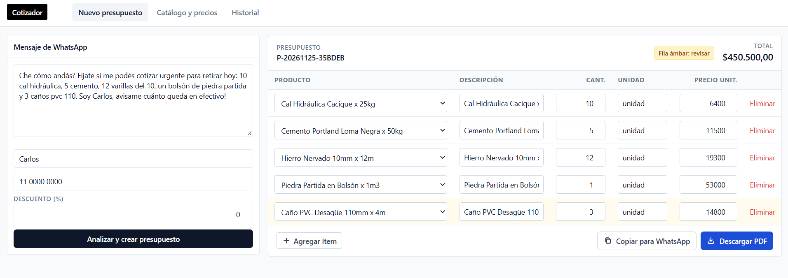
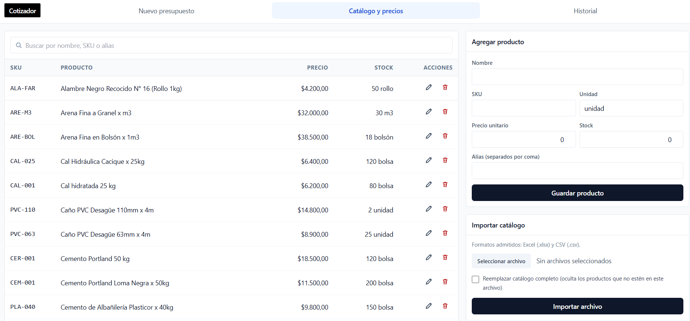
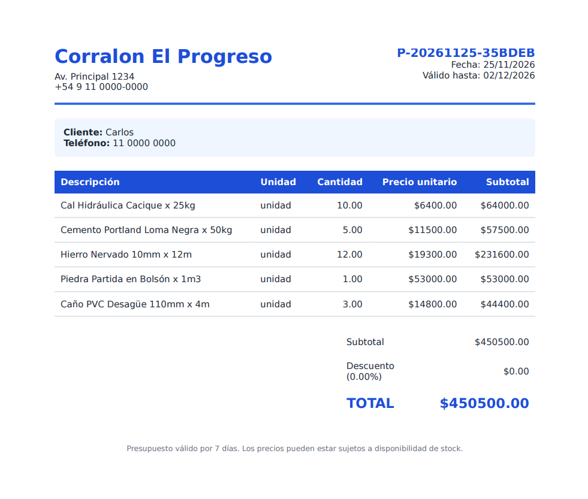

# Cotizador Automático para Comercios

MVP para corralones, ferreterías y otros comercios que permite convertir pedidos informales en presupuestos editables y descargables en PDF. La aplicación combina extracción de datos con IA, búsqueda difusa sobre un catálogo propio y revisión humana antes de emitir el presupuesto.
Su objetivo es automatizar el proceso de un empleado de leer detalladamente cada mensaje enviado y tener que redactar uno por uno los presupuestos.

## Capturas de pantalla

### Nuevo presupuesto



### Catálogo y precios



### Presupuesto PDF



## Funcionalidades

- Extrae cliente, productos, cantidades y unidades de un mensaje informal de WhatsApp con Google Gemini.
- Busca productos y alias en el catálogo con RapidFuzz; señala coincidencias dudosas o con stock insuficiente para revisión.
- Obtiene precios y stock del catálogo. La IA no calcula ni inventa precios.
- Permite editar presupuestos, seleccionar productos, cambiar cantidades y precios, y aplicar descuentos si se desea.
- Genera presupuestos en PDF con validez de siete días.
- Administra productos manualmente o mediante importación de archivos Excel (`.xlsx`) y CSV (`.csv`).
- Permite reemplazar el catálogo mediante baja lógica de los SKU que no están en el archivo, conservando el historial de presupuestos.
- Lista presupuestos recientes y permite volver a descargar sus PDF.

## Tecnologías

| Tecnología | Uso |
| --- | --- |
| Python 3.11 | Lenguaje del backend |
| FastAPI y Uvicorn | API HTTP y servidor ASGI |
| SQLModel y SQLite | Modelos y persistencia de datos |
| Pydantic v2 | Validación de datos y respuesta estructurada de Gemini |
| `google-genai` | Extracción de productos y cantidades con Gemini |
| RapidFuzz | Búsqueda aproximada de productos y alias |
| Pandas y OpenPyXL | Lectura e importación de CSV y Excel |
| Jinja2 y WeasyPrint | Plantillas HTML y generación de PDF en memoria |
| HTML, Tailwind CSS y JavaScript | Interfaz web sin frameworks JavaScript |
| Docker | Entorno reproducible con las dependencias nativas de WeasyPrint |

SQLite se utiliza por defecto. La conexión se configura con `DATABASE_URL`; para utilizar otro motor también hay que instalar su driver correspondiente.

## Requisitos

- Docker Desktop con el motor de contenedores Linux, recomendado para Windows.
- Una clave de API de Google para usar la extracción con Gemini.

También se puede ejecutar con Python 3.11 o superior, aunque WeasyPrint requiere dependencias nativas del sistema operativo. Docker ya incluye las librerías Linux necesarias.

## Configuración

Creá un archivo `.env` en la raíz del proyecto. No compartas ni subas este archivo: contiene configuración local y puede incluir credenciales.
El archivo `.dockerignore` también evita que el `.env`, las bases locales y las cachés se copien dentro de la imagen.

```dotenv
GOOGLE_API_KEY=tu_clave_de_google
GEMINI_MODEL=gemini-2.5-flash
GEMINI_FALLBACK_MODEL=gemini-2.5-flash-lite
DATABASE_URL=sqlite:///./cotizador.db
ALLOWED_HOSTS=localhost,127.0.0.1
COMMERCE_NAME=Mi comercio
COMMERCE_ADDRESS=
COMMERCE_PHONE=
```

La clave de Google es necesaria para analizar mensajes. Los modelos principal y de respaldo se pueden cambiar mediante sus variables de entorno. El nombre, domicilio y teléfono del comercio se incluyen en el PDF.

## Ejecutar con Docker

Desde PowerShell, CMD o una terminal Linux/macOS, en la carpeta del proyecto:

```bash
docker build -t cotizador .
docker run -d --name cotizador --cap-drop=ALL --security-opt=no-new-privileges:true -p 127.0.0.1:8000:8000 --env-file .env -e DATABASE_URL=sqlite:////data/cotizador.db -v cotizador-data:/data cotizador
```

El proceso dentro del contenedor corre sin privilegios de root. El volumen Docker `cotizador-data` conserva la base SQLite aunque se detenga o se reemplace el contenedor. No borres ese volumen si necesitás mantener el catálogo y el historial.
El proceso de la aplicación corre con el usuario no privilegiado `10001`.

Abrí [http://localhost:8000](http://localhost:8000). La documentación interactiva de la API está disponible en [http://localhost:8000/docs](http://localhost:8000/docs).

Comandos útiles:

```bash
docker logs -f cotizador
docker stop cotizador
docker start cotizador
```

Para reconstruir la imagen después de cambiar el código, quitá y volvé a crear el contenedor. El volumen de datos se mantiene:

```bash
docker stop cotizador
docker rm cotizador
docker build -t cotizador .
docker run -d --name cotizador --cap-drop=ALL --security-opt=no-new-privileges:true -p 127.0.0.1:8000:8000 --env-file .env -e DATABASE_URL=sqlite:////data/cotizador.db -v cotizador-data:/data cotizador
```

Si ya tenías el volumen `cotizador-data` de una versión anterior que corría como root, después de detener y quitar el contenedor y reconstruir la imagen, ejecutá una sola vez este comando para ajustar la propiedad de los archivos sin borrar la base:

```bash
docker run --rm --user 0:0 --entrypoint chown -v cotizador-data:/data cotizador -R 10001:10001 /data
```

## Ejecutar localmente

1. Creá y activá un entorno virtual con Python 3.11 o superior.

   En PowerShell:

   ```powershell
   py -3.11 -m venv .venv
   .\.venv\Scripts\Activate.ps1
   ```

2. Instalá las dependencias:

   ```bash
   python -m pip install -r requirements.txt
   ```

3. Creá el archivo `.env` siguiendo la sección de configuración.
4. Iniciá la aplicación:

   ```bash
   uvicorn app.main:app --reload --host 127.0.0.1
   ```

5. Abrí [http://localhost:8000](http://localhost:8000).

En Windows, se recomienda Docker para evitar instalar manualmente las dependencias nativas de WeasyPrint.

## Importar el catálogo

Los archivos deben incluir una columna SKU y una columna de nombre de producto. También se aceptan columnas opcionales para alias, unidad, precio y stock.

Ejemplo CSV:

```csv
sku,nombre,aliases,unidad,precio,stock
CER-050,Cemento Portland 50 kg,"cemento, bolsa cemento",bolsa,18500,120
ARE-001,Arena fina,"arena, arena fina",m3,18500,35
```

La importación actualiza los productos existentes por SKU y crea los nuevos. Al activar **Reemplazar catálogo completo**, los SKU que no aparezcan en el archivo quedan inactivos; no se borran físicamente y las referencias históricas se conservan.

## API principal

| Método | Ruta | Descripción |
| --- | --- | --- |
| `GET` | `/api/products` | Lista productos activos |
| `POST` | `/api/products` | Crea un producto o actualiza/reactiva uno por SKU |
| `PUT` | `/api/products/{product_id}` | Modifica un producto existente |
| `DELETE` | `/api/products/{product_id}` | Desactiva un producto sin borrarlo físicamente |
| `POST` | `/api/products/import` | Importa un catálogo `.xlsx` o `.csv` |
| `POST` | `/api/quotes/parse-message` | Extrae el pedido, busca productos y crea un borrador |
| `PATCH` | `/api/quotes/{quote_id}` | Edita el presupuesto y recalcula sus importes |
| `GET` | `/api/quotes/{quote_id}/pdf` | Genera y devuelve el PDF; confirma el presupuesto |
| `GET` | `/api/quotes` | Lista los presupuestos recientes |

## Estructura del proyecto

```text
app/
  main.py                 Aplicación FastAPI y carga inicial del catálogo
  database.py             Configuración de la base de datos
  models.py               Tablas SQLModel
  schemas.py              Esquemas de validación y respuesta
  routers/
    products.py           API de catálogo e importación
    quotes.py             API de presupuestos
  services/
    ai_extractor.py       Extracción estructurada con Gemini
    catalog_matcher.py    Coincidencia de productos con RapidFuzz
    pdf_generator.py      Renderizado de PDF
  static/
    app.js                Interacciones de la interfaz
  templates/
    index.html            Interfaz principal
    quote_pdf.html        Plantilla del presupuesto PDF
Dockerfile
requirements.txt
```

## Seguridad y alcance

Este MVP no incluye autenticación ni control de acceso. Ejecutalo solo en la computadora local: el comando Docker publica el puerto únicamente en `127.0.0.1`, valida los encabezados `Host`, limita el acceso a la API mediante cabeceras anti-cache y reduce capacidades del contenedor. Los mensajes de presupuesto se envían a Google Gemini para su extracción; no incluyas información sensible que no estés autorizado a compartir con ese proveedor.

La aplicación todavía no está preparada para una red compartida ni para Internet. Para esos escenarios primero hay que implementar autenticación y autorización, HTTPS, protección CSRF apropiada para el método de autenticación elegido, límites de solicitudes, copias de seguridad y una configuración segura de proxy. No configures `ALLOWED_HOSTS=*` como atajo.
